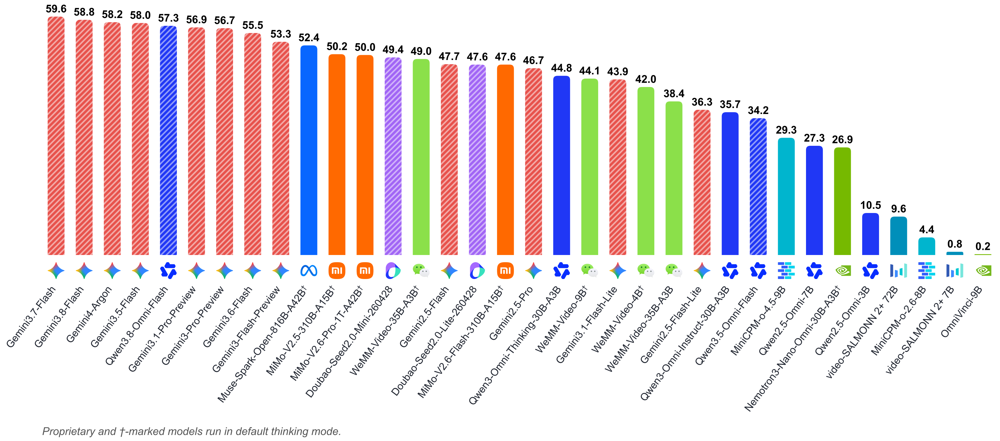
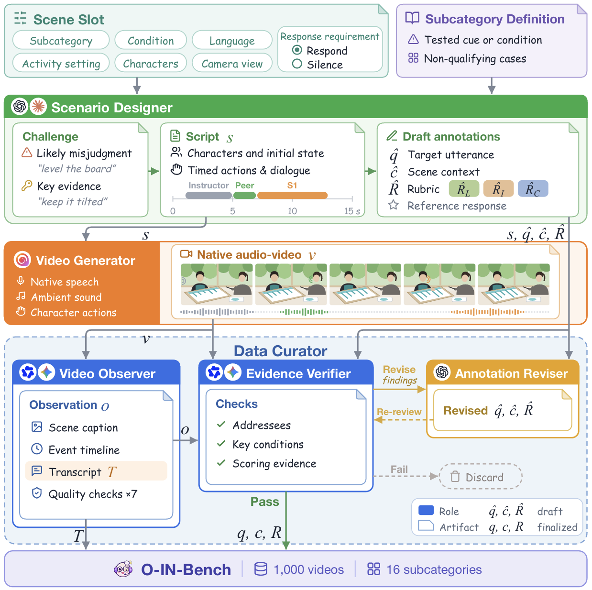
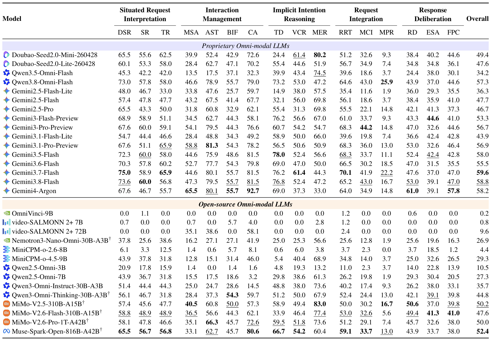

<div align="center">
<h1>Can Omni-modal LLMs Understand Spoken Intentions?</h1>

<p>
  <a href="https://arxiv.org/abs/2611.24706"></a> &ensp;
  <a href="https://xxayt.github.io/O-IN-Bench/"></a> &ensp;
  <a href="https://github.com/xxayt/O-IN-Bench"></a> &ensp;
  <a href="https://huggingface.co/datasets/xxayt/O-IN-Bench"></a> &ensp;
</p>

<div>
    <a href='https://xxayt.github.io/' target='_blank'>Zijie Xin</a><sup>1</sup>&emsp;
    <a href='' target='_blank'>Tianyi Wang</a><sup>2</sup>&emsp;
    <a href='https://daozezhang.github.io/' target='_blank'>Daoze Zhang</a><sup>2</sup>&emsp;
    <a href='https://yangjie-cv.github.io/' target='_blank'>Jie Yang</a><sup>2</sup>&emsp;
    <a href='https://scholar.google.com/citations?user=RzIjbf0AAAAJ' target='_blank'>Changli Tang</a><sup>2</sup>&emsp;
    <a href='https://weiqijie.github.io/' target='_blank'>Qijie Wei</a><sup>1</sup>&emsp;
    <a href='https://scholar.google.com/citations?user=38dACd4AAAAJ&hl=zh-CN&oi=ao' target='_blank'>Fengyun Rao</a><sup>2</sup>&emsp;
    <a href='https://li-xirong.github.io/' target='_blank'>Xirong Li</a><sup>1</sup>&emsp;
</div>
<div>
    <sup>1</sup> Renmin University of China&emsp;
    <sup>2</sup> WeChat Vision, Tencent Inc.&emsp;
</div>
</div>

<p align="center">
  
</p>

## 📢 News

- **[2026/11/26]** Released the [evaluation code](https://github.com/xxayt/O-IN-Bench).
- **[2026/11/20]** Released the [paper](https://arxiv.org/abs/2611.24706) and [dataset](https://huggingface.co/datasets/xxayt/O-IN-Bench).

## 👀 Overview

**O-IN-Bench** evaluates whether omni-modal LLMs understand spoken intentions through 1,000 Chinese and English videos with native speech. Models watch a complete video and produce one text response, or `[SILENCE]` when no response is needed.

## ✨ Key Highlights

- **Native audio-video requests:** Understand the user's need from speech and the shared scene.
- **Five categories and 16 subcategories:** Cover request interpretation, interaction management, implicit intentions, request integration, and response deliberation.
- **Separate judgments:** Evaluate language, intent, and content with sample-specific rubrics.
- **Contrastive pairs:** Test whether the response changes when a key scene condition changes.

## 🏗️ O-IN-Engine

O-IN-Engine generates native audio-video samples from scripts, then checks the resulting videos to revise and verify their annotations and scoring rubrics. See the [paper](https://arxiv.org/abs/2611.24706) for the construction pipeline.

<p align="center">
  
</p>

## 🔧 Dependencies and Installation

Requires Python 3.10+.

```bash
pip install -r requirements.txt
```

Download the dataset from [Hugging Face](https://huggingface.co/datasets/xxayt/O-IN-Bench), and set `DATA_ROOT` to its local directory.

## 🚀 Evaluation

Run the following commands from the repository root. Set the paths and parameters at the top of the scripts, or export them before running. Inference and scoring are separate commands.

```bash
export DATA_ROOT=/path/to/O-IN-Bench
export API_BASE=https://your-endpoint/v1
export API_KEY=your-api-key
export MODEL_NAME=your-model
export OUTPUT_DIR="./outputs/${MODEL_NAME}"
bash scripts/run_inference.sh

export JUDGE_API_BASE=https://your-judge-endpoint/v1
export JUDGE_API_KEY=your-judge-key
export JUDGE_MODEL=gpt-6-luna
export PREDICTIONS="${OUTPUT_DIR}/predictions.jsonl"
export SCORE_DIR="${OUTPUT_DIR}/scores"
bash scripts/run_score.sh
```

Models receive the complete video with its original audio. Predictions and evaluation results are saved under `outputs/<model_name>/`.

## 📊 Experiments Results

**Evaluation results of different omni-modal LLMs on O-IN-Bench.**

<p align="center">
  
</p>

## 🤝 Acknowledgement

Our evaluation uses [LMMs-Eval](https://github.com/EvolvingLMMs-Lab/lmms-eval). We thank its contributors for their work.

## ✏️ Citation

If you find this work useful, please consider citing:

```bibtex
@article{xin2026oinbench,
  title={Can Omni-modal LLMs Understand Spoken Intentions?},
  author={Xin, Zijie and Wang, Tianyi and Zhang, Daoze and Yang, Jie and Tang, Changli and Wei, Qijie and Rao, Fengyun and Li, Xirong},
  journal={arXiv preprint arXiv:2611.24706},
  year={2026}
}
```

## 📜 License

O-IN-Bench is licensed under the [CC BY-NC-SA 4.0 License](./LICENSE).

## 📬 Contact for Issues

For questions about this project, please contact [xinzijie@ruc.edu.cn](mailto:xinzijie@ruc.edu.cn).
